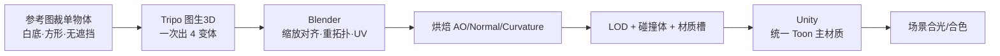

# 资产拆分方案 · Tripo 生成 vs Blender 搭建

> 基于四张章节场景参考图（`art_refs/`）与故事背景做的资产生产拆分。
> 技术栈：Tripo（图生 3D）+ Blender（重拓扑/硬表面/绑定）+ Unity。
> 标注图：`asset_split/tripo_ch1.png` ~ `tripo_ch4.png`（实线 = Tripo 直出，虚线 = Tripo 只出母版，其余 Blender 加工）。

---

## 0. 一句话结论

| 类别 | 交给谁 | 为什么 |
|---|---|---|
| 有机、不规则、有"雕刻感"的东西（怪物、珊瑚、骨骸、雕像、鲸骨、玩家） | **Tripo 出母版** | 人手建模最贵、AI 最擅长；形体对了细节可后期修 |
| 硬表面、建筑、可拼接、要精确尺寸、薄结构（柱、平台、栏杆、锁链、铁笼、石板、铜环、碑、钟） | **Blender** | Tripo 会把这些做成"一坨"，且拼接/贴地对齐不可控 |
| 水、雾、光柱、焦散、粒子、巨涡、流动符文 | **Unity Shader / VFX** | 根本不是网格资产 |
| 布料、旗帜、混天绫 | **Blender 布料 / 骨骼 + Shader** | Tripo 不处理动态布料 |

**核心判断不是"哪个好看"，而是"这件东西将来要不要精确、要不要拼接、要不要动"。** 要精确/拼接/动的，Blender；只要形体好看、能当母版复用的，Tripo。

---

## 1. 五条可执行判据（用它替代拍脑袋）

| # | 判据 | 选 Tripo | 选 Blender |
|---|---|---|---|
| 1 | 形体来源 | 有机、不规则、曲面多、细节靠"雕" | 硬表面、工业/建筑、规则几何、对称 |
| 2 | 精度要求 | 可缩放、比例近似即可 | 需要精确米数、要贴地、要和碰撞体对齐 |
| 3 | 拓扑要求 | 可以先高模，之后统一重拓扑 | 需要直接得到可开洞/可绑定的游戏级拓扑 |
| 4 | 复用方式 | 少量母版 → 实例、缩放、换材质 | 模块化 kit + 阵列/镜像/曲线 |
| 5 | 结构类型 | 实体块面、体积感强 | 薄片（链/网/栏杆/绳）、透明/折射、文字符文 |

---

## 2. Tripo 的六条红线（别用它做）

1. **链、绳、网、铁栅、栏杆**：细杆会被粘成一坨。→ Blender 曲线 + 阵列。
2. **精确玩法件**（平台、跳跃断口、摆荡锚点、可站立面）：必须毫米级对齐碰撞。→ Blender。
3. **建筑模块**（柱、墙、台阶、门框、屋脊）：要拼接、要 tiling、要 UV 对称。→ Blender。
4. **透明/折射**（水面、玻璃、水晶核心）：直接引擎做。→ Unity。
5. **布料/旗帜/绫**：→ Blender 布料模拟或骨骼 + Shader。
6. **文字、符文、铭刻**：→ 贴图 + decal + emission，别指望网格。

> 还有一条工程红线：**Tripo 的输出不能直接进 Unity**。它给的是三角面、UV 拼接混乱、软硬法线不分、没有 LOD、比例随机。每个 Tripo 资产都必须过一遍 Blender（见第 5 节）。

---

## 3. 四章拆分总表

### 第一章 东海 · 碎潮回廊

| 编号 | 物体 | 类别 | 方式 | 母版数 | 目标面数 LOD0 | 备注 |
|---|---|---|---|---|---|---|
| T1 | 归墟之喉 · 巨眼 | 有机怪物 | **Tripo 直出** | 1 | 90k | 触须 12–16 根，需手动骨架/形态键 |
| T2 | 红珊瑚扇（左） | 有机 | **Tripo 直出** | 2 变体 | 6k | 全章实例化，最划算的一件 |
| T3 | 红珊瑚扇（右） | 有机 | 复用 T2 | 0 | — | 只换缩放/旋转 |
| T4 | 柱头蟠龙雕饰 | 石雕 | Tripo 母版 | 1 | 18k | 柱身 Blender，柱头复用 4 次 |
| T5 | 哪吒（玩家） | 角色 | Tripo 出形 | 1 | 45k | Blender 重拓扑 + 绑定，全项目共用 |

**非 Tripo**：4 种断柱（模块化 kit）、走道/断口平台、石灯笼（车削 + 镂空）、远景残殿（低模剪影 + 视差层）、水面/雾/光柱/焦散（Unity）。

### 第二章 龙宫深狱

| 编号 | 物体 | 类别 | 方式 | 母版数 | 目标面数 | 备注 |
|---|---|---|---|---|---|---|
| T1 | 棘狱守卫（Boss） | 甲胄 + 有机 | **混合** | 1 套增生件 | 20k（增生件） | 甲胄主体 Blender，只让 Tripo 出背部有机增生/棘刺 |
| T2 | 骷髅门饰（左门楣） | 骨 + 铜 | **Tripo 直出** | 1 | 15k | 与 T5 共用材质 |
| T3 | 悬吊铁笼 · 囚徒骨堆 | 骨骸 | **Tripo 直出** | 1 | 20k | 笼体 Blender（铁栅不能给 Tripo） |
| T4 | 平台骨堆 / 镣铐尸骸 | 骨骸 | **Tripo 直出** | 3 变体 | 12k | 散落组合件 |
| T5 | 哪吒 | 角色 | 复用 | 0 | — | 同第一章 |

**非 Tripo**：铁门/铁栏（阵列 + 曲线）、锁链（曲线 + 实例）、吊笼框架、平台与断桥、炉火喷口（网格 + VFX）、血旗（布料）。

### 第三章 归墟虚空「海眼」

| 编号 | 物体 | 类别 | 方式 | 母版数 | 目标面数 | 备注 |
|---|---|---|---|---|---|---|
| T1 | 哪吒 | 角色 | 复用 | 0 | — | — |
| T2 | 虚空岩块 / 断台碎块 | 岩石 | **Tripo 直出（可选）** | 3–4 变体 | 4–8k | 这块 Blender Displace 也能替代，做不做看时间 |
| T3 | 铜环 · 龙首扣件 | 铜饰 | Tripo 母版 | 1 | 3k | 环本体 Blender 曲线，扣件实例 4 个 |
| T4 | 海眼 · 二阶段巨瞳 | 有机 | **Tripo（可选）** | 1 | 60k | 只有二阶段要做实体眼球才做；纯 VFX 可省 |

**非 Tripo**：悬浮封印石板（Blender + 符文贴图）、铜环本体（曲线 + 车削）、垂直光柱/星尘/巨涡（VFX）、断台（Blender）、碎屑（小件低模实例，不值得单独进 Tripo）。

### 第四章 龙骨沉殿「潮心」

| 编号 | 物体 | 类别 | 方式 | 母版数 | 目标面数 | 备注 |
|---|---|---|---|---|---|---|
| T1 | 鲸骨拱 / 椎骨天顶 | 骨骸 | **混合** | 2–3 段母版 | 25k/段 | Tripo 出母版，Blender 阵列 + 弯曲成拱 |
| T2 | 螭吻（Boss） | 有机怪物 | **Tripo 直出** | 1 | 70k | 龙首鱼身，手动骨架 + 腹内潮水特效 |
| T3 | 骨白雕像（左） | 石雕 | **Tripo 直出** | 2 变体 | 25k | 衣褶/残损是最难手工的部分，正好给 Tripo |
| T4 | 骨白雕像（右） | 石雕 | 复用 T3 | 0 | — | 换姿态/破损 |
| T5 | 潮蚀异化珊瑚 / 菌簇 | 有机 | **Tripo 直出** | 2 变体 | 10k | 前景压角 |
| T6 | 沉钟 · 钟顶龙钮 | 铜 | 混合 | 1 | 6k | 钟体车削，龙钮 Tripo |
| T7 | 哪吒 | 角色 | 复用 | 0 | — | — |

**非 Tripo**：潮纹碑（硬表面 + 发光符文）、沉钟钟体、龙宫柱、台阶平台、潮脉水流（VFX/Shader）。

### 汇总

- **Tripo 生成任务约 25 个**（其中可选项 4 个：虚空岩块 3 变体 + 二阶段巨瞳 1），其中"直出核心件"约 12 个、混合件 7 个、纯复用件 5 个。
- LOD0 面数总量约 **56 万三角面**，对一个 2.5D 横版属于宽裕区间。
- 复用率最高的是：哪吒（4 章）、珊瑚（全章）、骨堆（2 章）、雕像（同章 2 组）。

---

## 4. 标注图怎么读

| 图 | 文件 | 标记数 |
|---|---|---|
| 第一章 | `asset_split/tripo_ch1.png` | 5 |
| 第二章 | `asset_split/tripo_ch2.png` | 5 |
| 第三章 | `asset_split/tripo_ch3.png` | 4 |
| 第四章 | `asset_split/tripo_ch4.png` | 7 |

- **实线玫瑰红框**：建议直接 Tripo 生成，再进 Blender 重拓扑。
- **虚线橙框**：Tripo 只负责出"母版"，拼接/阵列/精修在 Blender。
- 每张图底部图例给出：编号、名称、为什么这么做、目标面数。
- 框是"大致范围"，不是精确裁切框；做 Tripo 输入图时需要重新裁成单物体白底（见 5.1）。

---

## 5. 管线：Tripo → Blender → Unity

### 5.1 Tripo 输入怎么准备（决定 80% 的质量）

1. 从参考图里**只裁一个物体**，抠掉背景，白底或透明底，方形构图，主体占画面 70%。
2. 同一物体给 **3–4 个角度**做多视图生成，比单图成功率高很多。
3. 提示词只写**形体**，不写光效材质：
   `a giant abyssal eye creature, organic sculpted surface, curled tentacles, single object, centered`
4. 一次出 4 个变体，只挑形体最对的，**不要在 Tripo 里修**（改不动）。
5. 以你所订阅版本的界面为准，别指望它的"自动重拓扑"能直接进引擎。

### 5.2 Blender 处理（每件 Tripo 资产必做）

| 步骤 | 做什么 | 验收 |
|---|---|---|
| ① 对齐 | 1 单位 = 1 米；原点放脚底/挂点；面朝 +X（2.5D 侧视） | 和门高/人高对上 |
| ② 重拓扑 | 有机件 QuadRemesher；角色/Boss 脸部手 retopo | 四边面为主，无三角地狱 |
| ③ UV | Smart UV Project 起步 → 检查重叠 | 无重叠，1–2 张 2K 内 |
| ④ 烘焙 | AO、Normal、Curvature、Thickness | Curvature 留给三渲二阶跃 |
| ⑤ 材质 | 拆 3–4 槽：主体 / 金属 / 发光 / 透明 | 发光单独 mask |
| ⑥ LOD | LOD0/1/2 + 简化碰撞体（UCX_ 前缀） | 三档递减 50%/70% |
| ⑦ 导出 | FBX / GLB，单 Root，无动画残留 | Unity 导入无警告 |

### 5.3 Unity 侧

- 所有角色/怪物/场景件走**同一个 Shader Graph 主材质**：Base Color → 3–4 阶 Ramp → 冷色 Rim（`#4FE8FF`，强度 0.3–0.5）→ Emission Mask。
- **不要直接用 Tripo 的 PBR 贴图**，把它当颜色输入，金属度/粗糙度统一重设，否则 Tripo 件和 Blender 件在同一光照下会"跳"。
- 珊瑚、骨堆、碎块用 GPU Instancing；建筑模块走 LOD Group + Occlusion。
- 2.5D 侧视可以关掉大量背面/内部面，省一半面数。

### 5.4 风格统一（最容易被忽略的一步）

Tripo 的默认质感偏"写实塑料"，而我们定的是**半写实 3D + Toon 阶跃 + 冷色轮廓光**。所以每件 Tripo 资产进引擎后必须：

1. 压掉高光锐度（Toon ramp 只有 3–4 阶，别让高光连续过渡）；
2. 暗部乘 AO，别让 AI 的"软阴影"留在贴图里；
3. 统一加冷色 rim，把有机体和硬表面拉到同一个光环境；
4. 颜色往章节色板靠（第一章 `#0B3A42`，第四章 `#2E6B5B`），别直接用 Tripo 的原始底色。

---

## 6. 面数 / 贴图预算

| 类别 | LOD0 | LOD1 | LOD2 | 贴图 | 材质槽 |
|---|---|---|---|---|---|
| Boss（巨眼 / 守卫 / 螭吻 / 巨瞳） | 70–120k | 25–40k | 8–12k | 2K | ≤4 |
| 玩家（哪吒） | 45–60k | 18k | 6k | 2K | ≤4 |
| 小怪（9 种） | 10–18k | 5k | 2k | 1K | ≤3 |
| 有机装饰母版（珊瑚/骨堆/岩块） | 6–25k | 3k | 1k | 1K | ≤2 |
| 建筑模块 | 2–6k | 1k | — | 1K（可 tiling） | ≤2 |
| 远景剪影 | 300–800 | — | — | 512 | 1 |

---

## 7. 验收清单（每件 Tripo 资产过一遍）

- ☐ 比例对得上参考图里的门高/人高（这是最容易翻车的一项）
- ☐ 原点、朝向、单一 Root，无残留变换
- ☐ 无非流形、无内部面，法线朝外
- ☐ UV 无重叠，贴图 ≤2K，通道打包（R=AO / G=Rough / B=Curv）
- ☐ LOD 三档 + 独立碰撞体
- ☐ 材质槽 ≤4，发光走 mask
- ☐ 放进 Unity 场景，和周围 Blender 件同一光照下不"跳"

---

## 8. 建议开工顺序（先做这 5 个）

1. **哪吒** —— 四章都用，最先验证角色管线。
2. **归墟之喉 · 巨眼** —— 第一章 Boss，决定整章气质。
3. **红珊瑚扇** —— 最省力、复用最高，用来练 Tripo→Blender 的流水线。
4. **鲸骨拱** —— 第四章面积最大，决定"龙骨沉殿"能不能立住。
5. **螭吻** —— 第四章 Boss，最后压轴。

理由：先用"铺量件 + 两个 Boss"验证画风成立，再批量生产。别一上来就做 9 种小怪。

---

## 9. 需要你拍板的 4 件事

1. **海眼二阶段巨瞳**要不要实体网格？（要 → 做第三章 T4 60k；不要 → 纯 VFX 省一件）
2. **棘狱守卫**接受"甲胄 Blender + 有机增生 Tripo"的混合吗？还是整体 Blender？
3. **目标平台**：PC 独显 / 移动？这决定面数上限和 LOD 档数（当前预算按 PC 给）。
4. 要不要我把标注框裁成**单物体输入图**（白底、方形、去背景），Tripo 可以直接吃？

> 备注：仓库里现在还是 Godot 原型（`E:\godot_game_by_fable`）。参考图与本文的拆分方案与引擎无关，管线按 Unity 写；Godot 那套只作为美术锚点保留。
